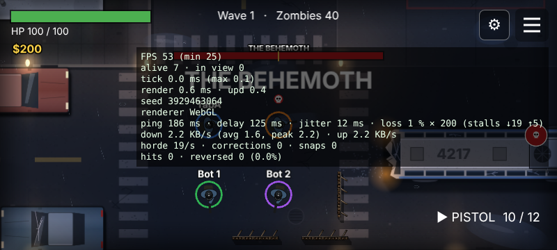
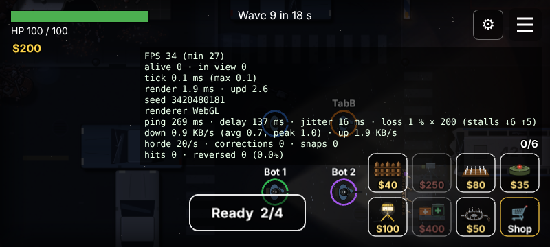

# Network pass two-tab smoke, 2026-11-25 (Story 8.8 builder, brief addendum line 34)

**Setup.** Real server (story-8-8 branch, port 2681, dev switches per run), Vite dev client (port 5281, `/api` → 2681), two headless Chromium tabs (800 × 360) both opened with `?lag=150&jitter=20&loss=1&debug=1` (the new lossy line in the dev throttle), plus 2 bots joined to the same room with `npm run bots -- --room <code> --count 2 --lag 150 --jitter 20 --loss 1` (the new in-process line, stalls both ways). Tab B's game loop was put to sleep for 8 s (`window.__game.loop.sleep()` / `wake()`, the hidden-tab simulation) across each moment below; state read from each tab's mirror World. Machine: 4 cores, load ≈ 1–2 during the runs. Script: `tools/netaudit/smoke2tab.cjs` (review R6; its header has the exact steps: server with dev switches, a local Vite config with the `/api` proxy, `node tools/netaudit/smoke2tab.cjs <outDir> [clientPort] [serverPort]`).

| Run | Server dev switches | What happened | Hidden tab (B, 8 s) | Result |
| --- | --- | --- | --- | --- |
| 1 | `DEV_START_WAVE=9 DEV_EVENTS=car_alarm@9` | Stage 5 build start (wave 8 → 9), wave 9, car alarm (event kind 0) at tick ~776, team wiped at tick 1008 (idle tabs + 2 bots) | across the run start / stage-5 build start: B tick 245 vs A 246 after waking; across the car-alarm start: B 1003 vs A 1005 | both tabs reached Results together (tick 1008); 0 console errors, 0 page errors |
| 2 | `DEV_START_WAVE=10 DEV_WAVE_MIX=walker` | Stage 5 build, wave 10, wiped at tick 1020 before the Behemoth arrived | across the run start / build start: 248 vs 248 | both tabs on Results; 0 errors |
| 3 | `DEV_BOSS_WAVES=1` | Behemoth in wave 1: walk → telegraph (state 3) → attacks, several telegraphs; wiped at tick 1168 | across a boss telegraph (state 3 at tick 799): B came back at tick 1020 vs A 1020, boss state agreeing on both tabs | both tabs on Results; 0 errors |

Bots' line per run: 20–30 stalls up / 37–52 down (`bots_line`). Tab overlay (screenshot below): `ping 186 ms · delay 125 ms · jitter 12 ms · loss 1 % × 200 (stalls ↓19 ↑5)`, reversed hits 0.

**Not reached: the evacuation vote.** The vote opens only after the Behemoth is beaten in wave 10; two bots and two idle tabs wiped before that in all three tries (there is no online boss-HP dev switch, and the bots don't carry a dev balance override, so `DEV_ZOMBIE_DAMAGE_SCALE` refuses their join with `balance_mismatch`). The vote's own tests (`packages/shared/src/run/evacVote.test.ts`, `apps/server/src/rooms/RunRoom.vote.test.ts`, `apps/client/src/ui/voteModel.test.ts`, `tools/checks/votePollWiring.test.ts`) ran in the full gate. Story 8.8 changes no pacing, message budget or render clock (brief line 33), so the vote timers are untouched; the 4-phone test should still check a vote on the lossy line.

**What this smoke shows.** The lossy-line switches work end to end in a real browser and in the bots at the same time; a tab that slept 8 s across a build start, an event start and a boss telegraph caught up to within 0–2 ticks of the awake tab and showed the same phase and boss state; no console or page errors. It does not show feel (headless, no human input), real phones, real 4G or iOS Safari.
