# Milestone 1: what is this? (readability sheet)

**Do this alone, right after run A, without talking to the others.** Don't scroll back to look at your answers again later.

For each picture, write:
- **what it is** (a few words, a guess is fine; "don't know" is a good answer too);
- **bullets:** do your bullets go **through** it, or does it **stop** them? (through / stop / don't know)

Copy this block into the chat and fill it in:

```
Player:
1  what:            bullets:
2  what:            bullets:
3  what:            bullets:
4  what:            bullets:
5  what:            bullets:
6  what:            bullets:
7  what:            bullets:
8  what:            bullets:
9  what:            bullets:
10 what:            bullets:   + where exactly does it hurt you?
11 what:            bullets:
12 what:            bullets:
13-15 are these three different? what does each one do?
16 what is the survivor holding?
17 what is the survivor holding?
18 what:            bullets:            can you walk on it?
19 what:            bullets:            can you walk on it?
20 what:            bullets:            can you walk on it?
21 what:            bullets:            can you walk on it?   + what do the two circles mean?
22 what:            what does it do?
23 what:            bullets:   + when does it hurt you?
24 what is the survivor holding?
25 what is the survivor holding?
26 what:            what does it do?
27 what:            what does it do?
28 what is about to happen? where is it safe?
29 what is the green cloud? what does it do to you?
```

## 1
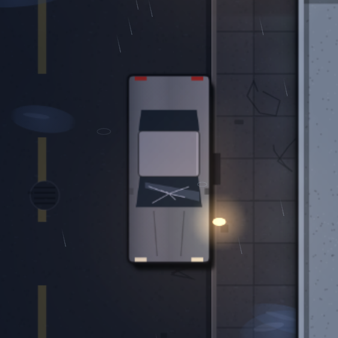

## 2
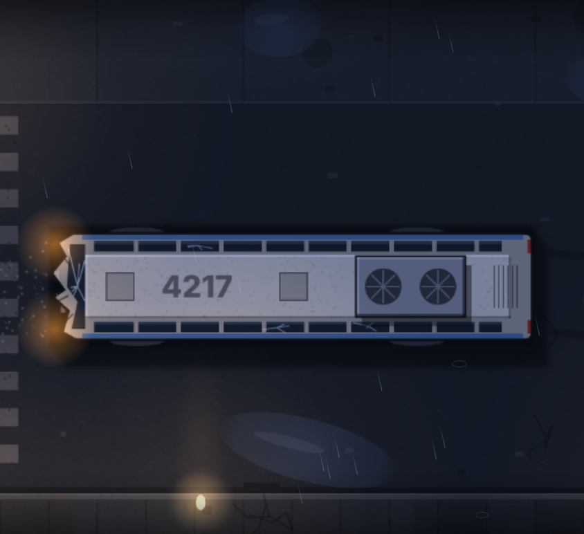

## 3
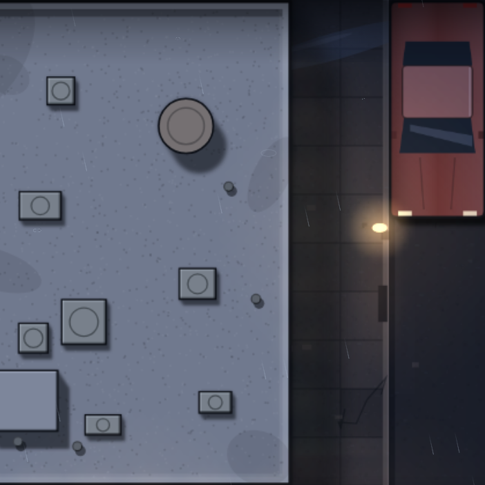

## 4: the small light
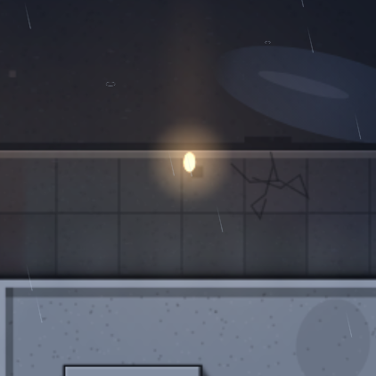

## 5
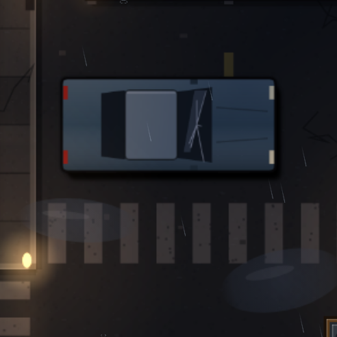

## 6
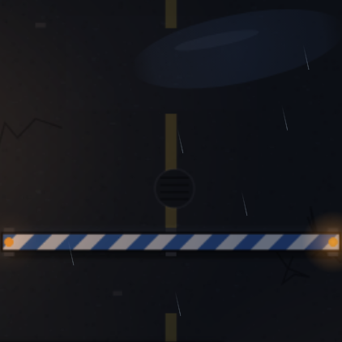

## 7
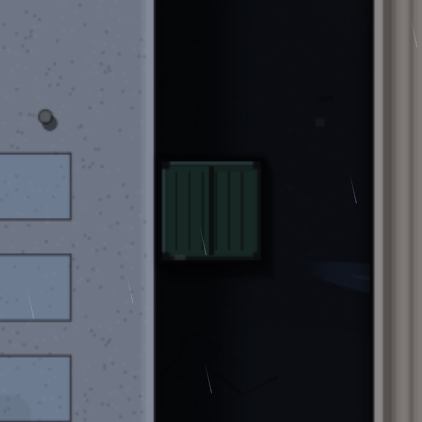

## 8
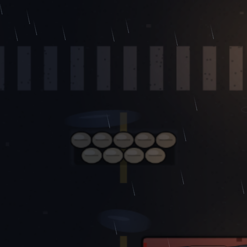

## 9
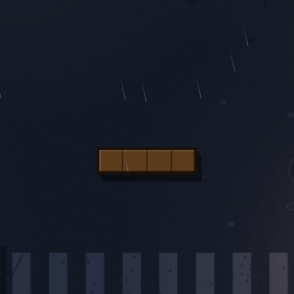

## 10
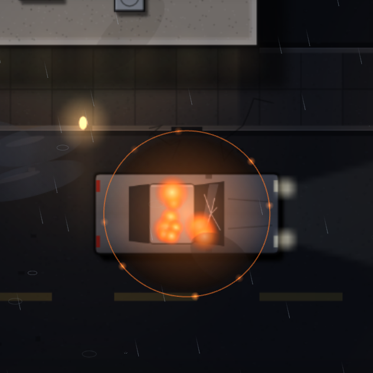

## 11
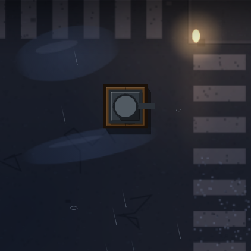

## 12: the wet patches on the road
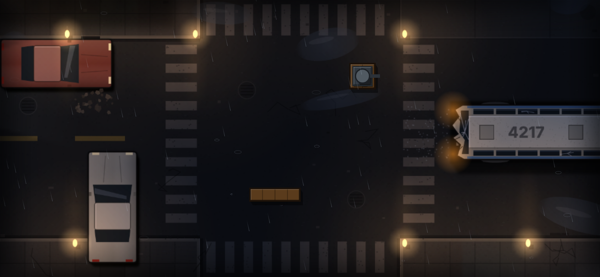

## 13, 14, 15
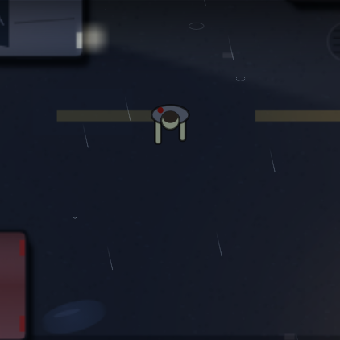 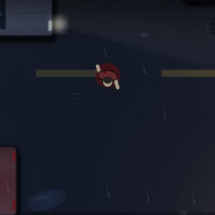 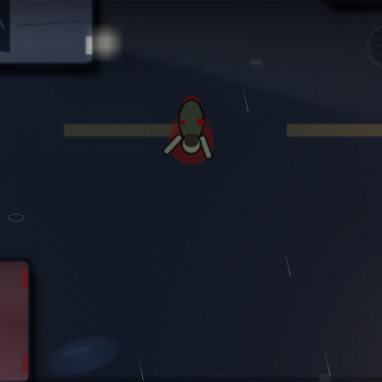

## 16, 17: what is the survivor holding? (Story 5.3: Shotgun, Assault Rifle)
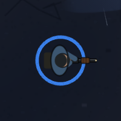 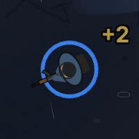
## 18 (Epic 5)
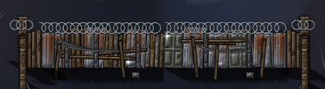

## 19 (Epic 5)
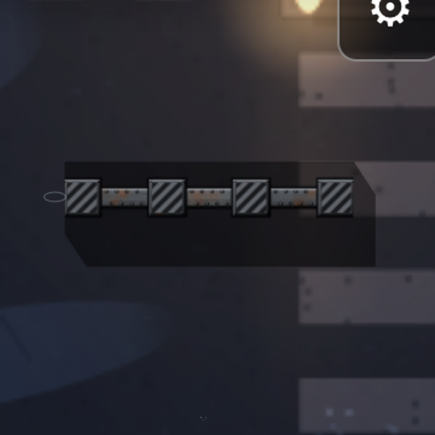

## 20 (Epic 5)
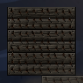

## 21 (Epic 5): the small round thing
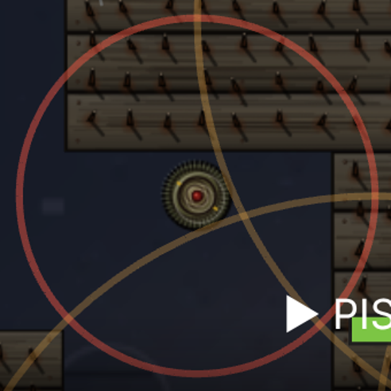

## 22 (Story 5.6)
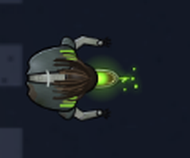

## 23: the green patch (Story 5.6)
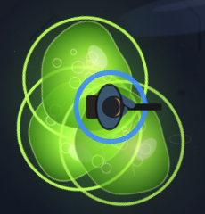

## 24, 25: what is the survivor holding? (Story 5.2)
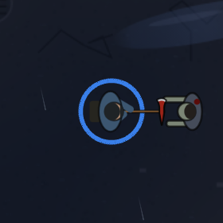 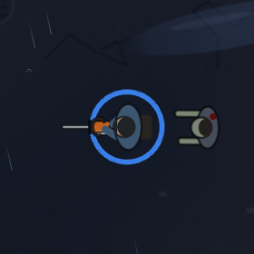

## 26 (Story 5.7)
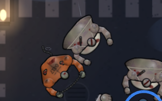

## 27 (Story 5.8)
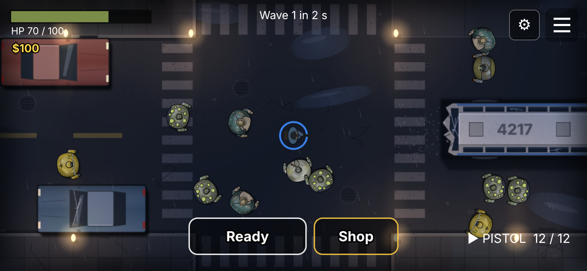

## 28 (Story 5.8)
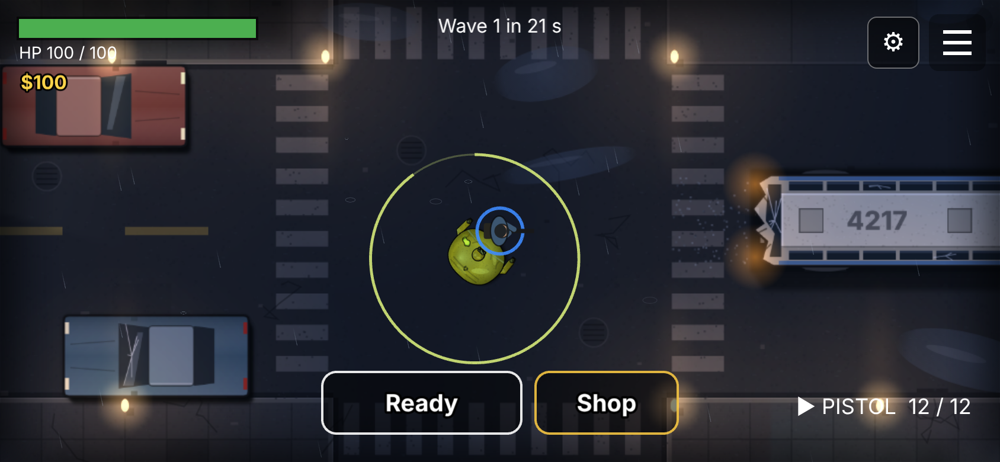

## 29 (Story 5.8)
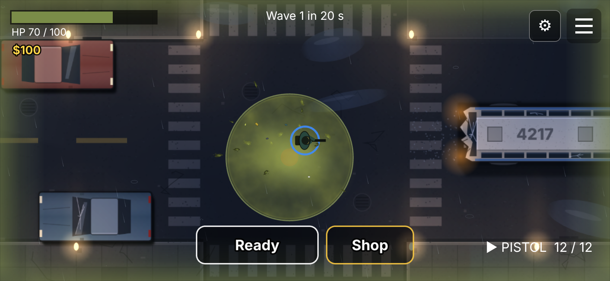

## 30: the small thing in the air, and the ring ahead (Story 5.5)
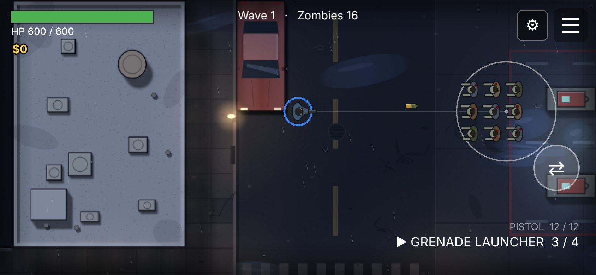

## 31: the orange ring at the car (Story 5.5)
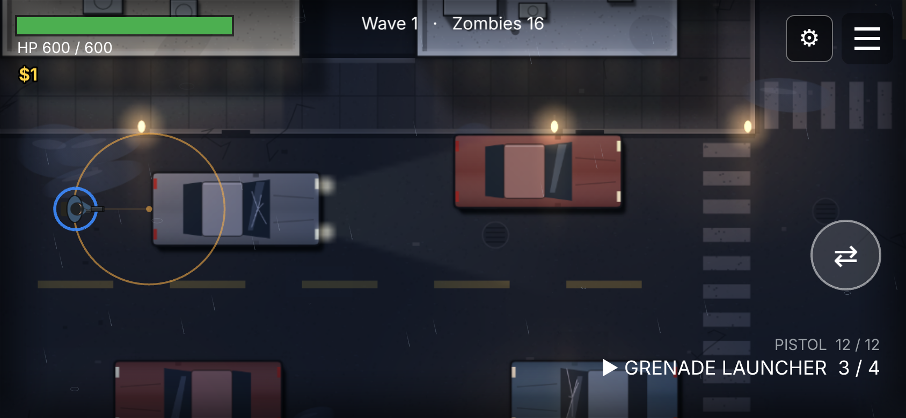

## 32, 33: two blasts (Story 5.5)
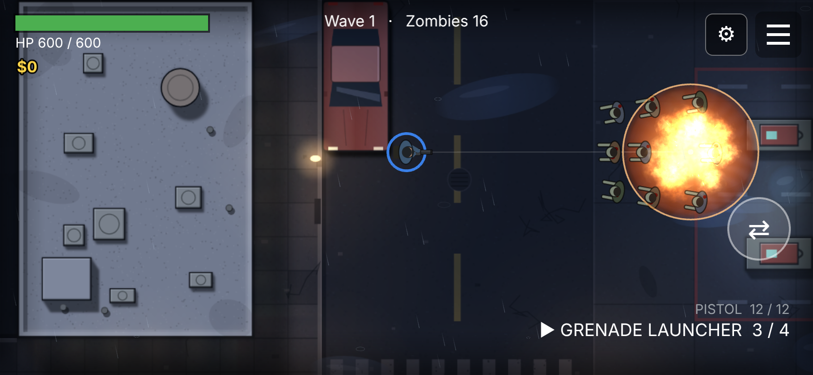 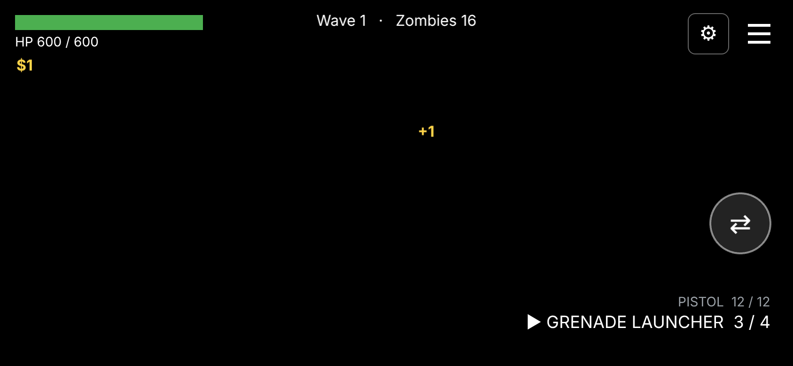

## 34, 35: what is the survivor holding, and what does it do? (Story 5.4)
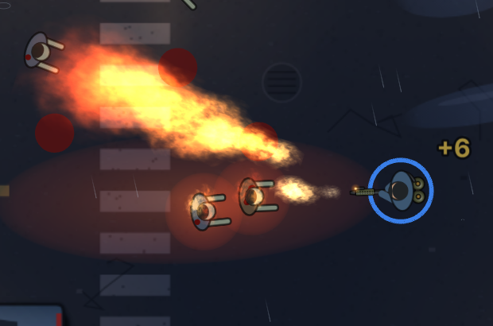 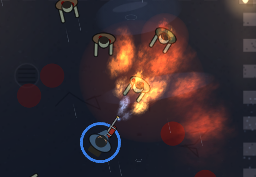

## 36: what is happening to these zombies? (Story 5.4)
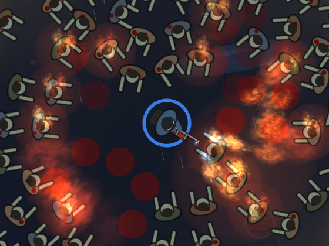
